<div align="center">

# Wireless CarPlay for the Chevrolet Equinox EV

**Open firmware for the Carlinkit CPC200-CCPA adapter, and an Android Automotive app that makes
CarPlay feel built in: fast to connect, full screen, and on the driver display.**

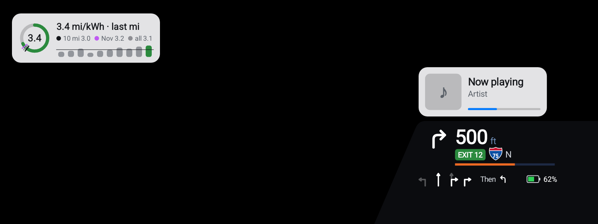

<sub>The driver display as the app draws it: turn card with lanes, exit sign and route shield, the
battery you will arrive with, now playing, and the Drive card. In the car, CarPlay's own map fills
the black area. (Bench screenshot, sample data.)</sub>

</div>

## Highlights

- **About 11 seconds to CarPlay.** From the moment the app starts the adapter to the first
  CarPlay picture: a median of 10.7 s over 44 drives, measured by the app itself.
- **Wireless, full screen, HEVC** at the screen's native size, with media, calls, Siri and
  navigation prompts on GM's own volume controls and the car's microphone.
- **CarPlay on the driver display.** Apple Maps' dedicated cluster map, with turn-by-turn, lanes,
  now playing, calls and live EV data drawn over it, in GM's look.
- **EV Insights on the car.** A permanent drive and charge log on the head unit, efficiency by
  route and weather, and an arrival-battery estimate fitted to your own driving.
- **An ordinary app.** No root on the car, no changes to the phone, nothing soldered. The adapter
  runs open firmware; the app installs through Google Play.

## Features

### The driver display

<table><tr>
<td width="50%">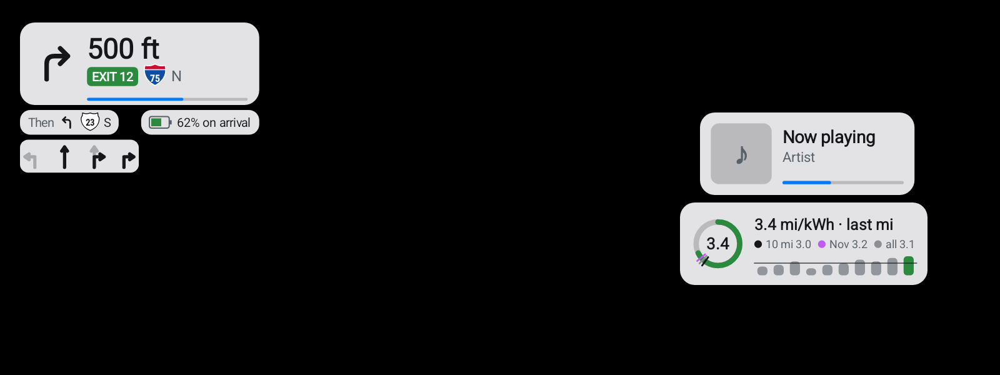</td>
<td width="50%">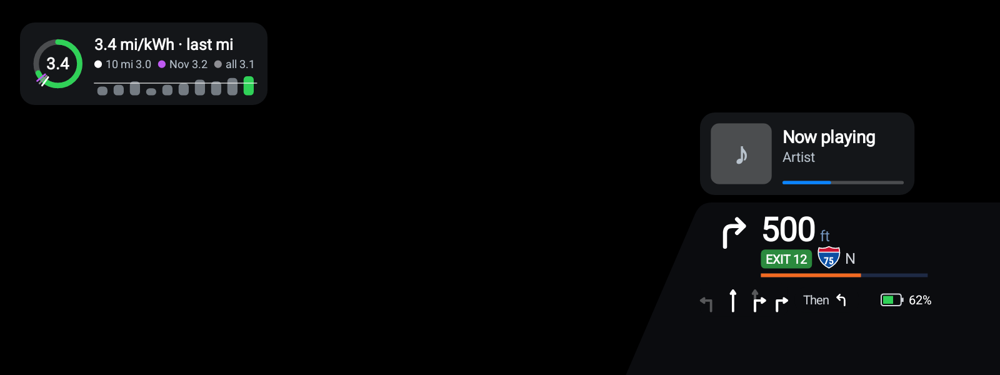</td>
</tr><tr>
<td><sub>The turn card floating top-left, with the turn after, the battery on arrival and lane arrows.</sub></td>
<td><sub>Docked in the gauges' style, at night.</sub></td>
</tr></table>

The Equinox's driver display is an ordinary Android display, so the app opens its own window there
and shows the map Apple Maps renders for instrument clusters. It stays up through whole routes,
gets out of the way when you pick another of GM's pages, and comes back when you return to the map
page. The cluster video carries the map only, so the app draws the rest itself from CarPlay's route
data:

- **Turn card:** the arrow, a countdown bar, the green exit sign, the road with its Interstate, US,
  state or county shield, and the turn after it. It can float anywhere or dock bottom-right, styled
  like GM's own gauges (top of the page).
- **Lane guidance:** every lane's arrows, with the lane to take highlighted.
- **Now playing and calls:** cover, title and progress, folding to a small pill during navigation;
  a call takes its place with the caller and a timer.
- **Day and night:** the cards follow the car's lighting, like CarPlay's map does.
- **Your layout:** drag each card into place on a miniature of the display, and size it
  (see [Settings](#settings-that-make-sense)).

When the map isn't on the driver display, CarPlay's turns go to GM's own cluster instead, with the
exit number, and the album art shows there between routes.

### Live EV data in the cluster

<table><tr>
<td width="50%">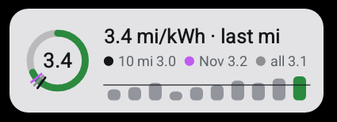<br>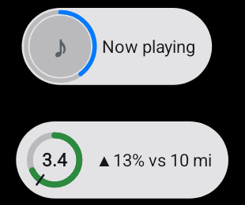</td>
<td width="50%">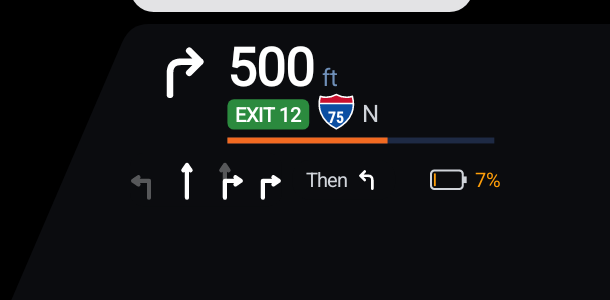</td>
</tr><tr>
<td><sub><b>Drive card:</b> your last mile against the last 10, this month and your lifetime
average, with a bar for each mile. Green when you're beating your average, amber when you're
not. It opens when you stop or the trend changes, and folds to a small ring while you drive
(below it, folded beside now playing).</sub></td>
<td><sub><b>Battery on arrival:</b> during an Apple Maps route, the turn card shows the charge
you'll arrive with, worked out on the car from the route's distance and expected speed, the
outside temperature and how this car has actually driven. Amber under 10%.</sub></td>
</tr></table>

### A media pane, with lyrics

<table><tr>
<td width="42%">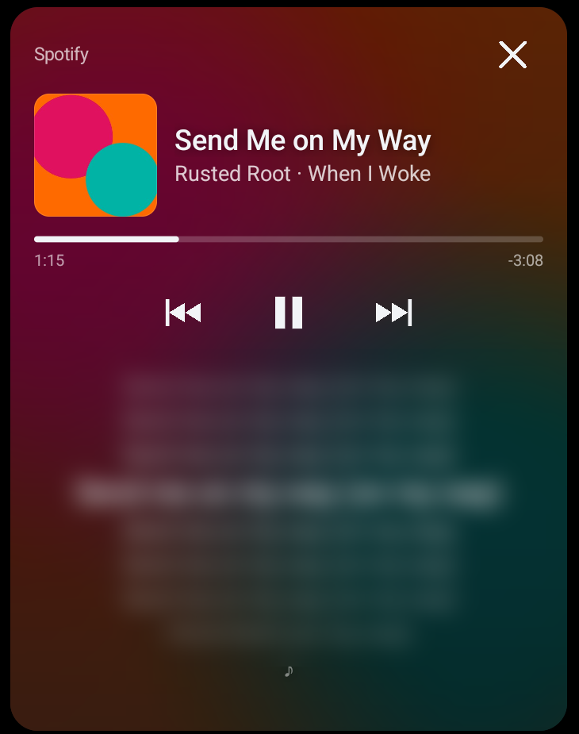</td>
<td>

Tap the glass beside CarPlay for a media pane: the artwork over a blurred backdrop of the cover,
the progress and the controls, and the song's **timed lyrics** with the line being sung
highlighted. It lays over the right of CarPlay or splits the screen, in any gear, so a passenger
can follow along. When it's hidden, a small now-playing chip sits beside CarPlay. <sub>(The
lyrics are blurred in this screenshot; the cover is a drawn sample.)</sub>

A **GM-style top bar** replaces the car's bars when you hide them: shortcuts into CarPlay's apps,
now playing, the app's settings, the time and the outside temperature.

</td></tr></table>

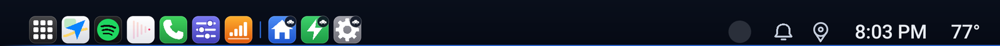

### EV Insights, on the car

<table><tr>
<td width="50%">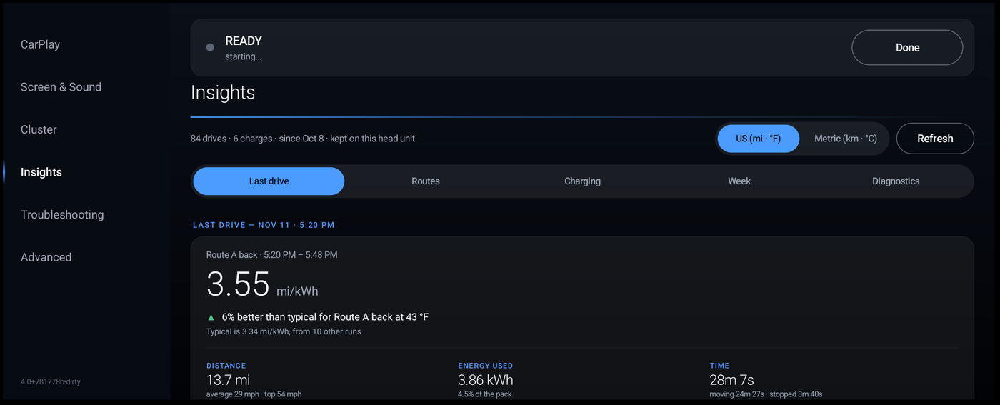</td>
<td width="50%">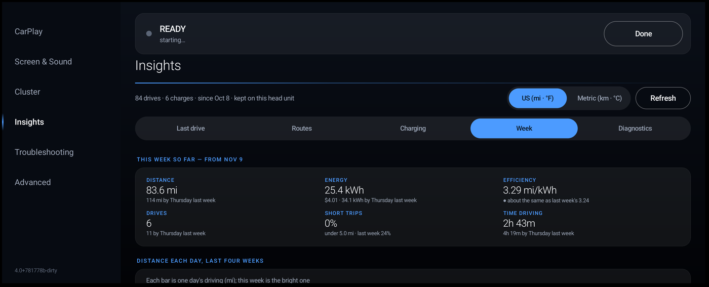</td>
</tr><tr>
<td width="50%">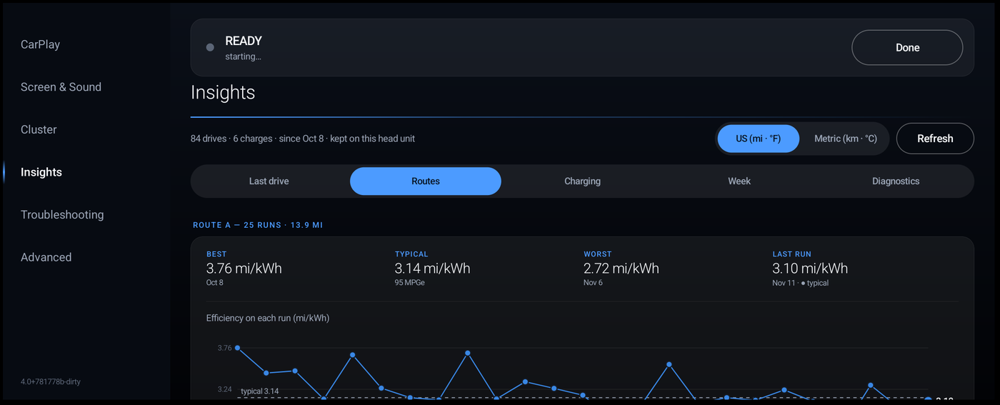</td>
<td width="50%">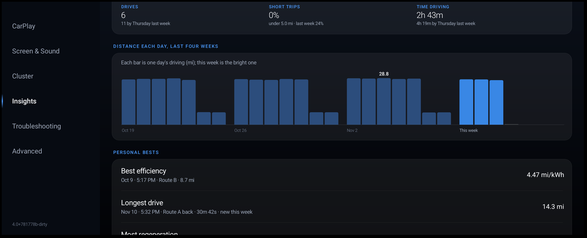</td>
</tr></table>

Every drive and charge is kept on the head unit and never uploaded: how a drive compared with your
usual for that route at that temperature, where the energy went (driving, warm-up, standing),
routes you repeat found automatically, charging sessions and cost, and the week at a glance.
Optional uploads to your own server feed a self-hosted web workbench
([`host/evinsights`](host/evinsights/README.md)), under a monthly data limit that never counts
Wi-Fi. <sub>(Screenshots use invented drives.)</sub>

### Settings that make sense

<table><tr>
<td width="50%">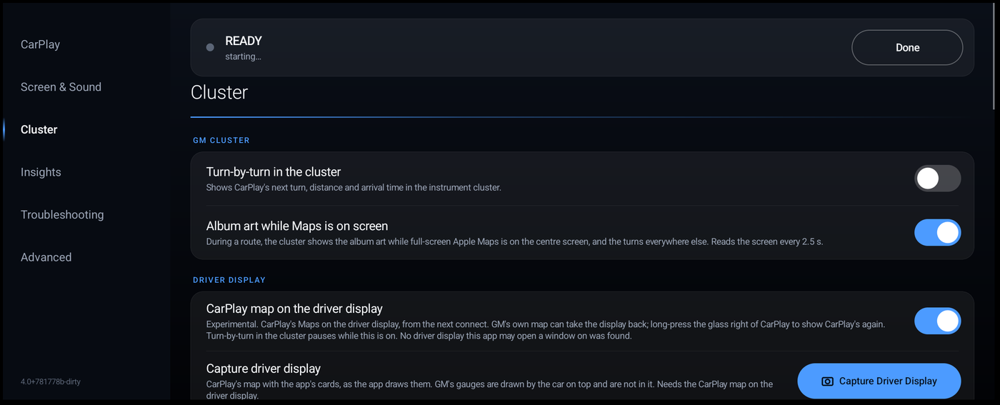</td>
<td width="50%">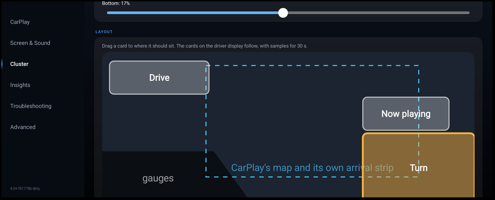</td>
</tr></table>

Tabs for CarPlay, Screen & Sound, Cluster, Insights, Troubleshooting and Advanced. The Cluster tab
holds GM's cluster, the driver display and a drag-and-drop editor for where each card sits.
Troubleshooting can capture the CarPlay screen or the driver display, and upload logs, waiting for
Wi-Fi when they're large.

### And the rest

- **More than one iPhone:** pair several and choose which connects first (new, needs the latest adapter firmware).
- **Steering wheel:** the voice button starts Siri; media keys work; calls ring through GM's audio.
- **Apple Maps knows it's an EV:** the car's battery, range and CCS1/J1772 connectors are sent to
  CarPlay. (Apple Maps doesn't show it yet; see [T7](docs/ops/08_FUTURE_TASKS.md).)
- **Drive-restricted UI and day/night** follow the car's gear and lights.
- **Self-healing connection:** walk away and back, and CarPlay and the driver display reconnect
  on their own.

## Status

Daily-driven on one Equinox EV with one iPhone (iOS 27). Working on the car: wireless CarPlay,
audio, calls, Siri, cluster turn-by-turn, the driver-display map with the turn, now-playing and call
cards, the media pane and the top bar. Newest, and not yet confirmed on the car: lane highlighting
and route shields, the Drive card and arrival estimate, and the walk-away fix for the driver
display (Play 246–249). Every item, with its evidence:
[docs/ops/04_OPEN_ITEMS.md](docs/ops/04_OPEN_ITEMS.md).

## How it works

```
iPhone ──Bluetooth: pairing, iAP2, MFi──▶ CCPA adapter (open firmware)
   └────Wi-Fi: the adapter's own access point──▶ CarPlay receiver on the adapter
                                                   │  USB, encrypted A/V (OCBM)
                                                   ▼
                              Android Automotive app on the head unit
                              decrypt · decode HEVC · render · touch · mic
                              main screen + driver display
```

The adapter keeps the parts Apple never changes: the iAP2 handshake, authentication on its genuine
MFi chip, pairing and key derivation. The app owns everything that changes with each iOS release,
so new CarPlay features usually land in an app update. On the Equinox, GM's firewall blocks the
phone from reaching the head unit directly, so the adapter runs its own Wi-Fi and the CarPlay
receiver, and forwards the still-encrypted video and audio to the app.

## Getting it

This is a hobby project for one car, not a product. To run it you would:

1. Flash the adapter's userspace with this firmware ([`docs/ops/00_BUILD_AND_DEPLOY.md`](docs/ops/00_BUILD_AND_DEPLOY.md));
   the signed boot stack is never touched, and [`docs/ops/01_RECOVERY.md`](docs/ops/01_RECOVERY.md)
   covers recovery.
2. Build the app ([`host/gm_ccpa`](host/gm_ccpa/README.md)) and install it through your own Google
   Play Console internal test track; Equinox owners report that the car refuses sideloaded APKs.

## Credits

Built on [lvalen91/ocbm](https://github.com/lvalen91/ocbm) by Tachi91, the open CPC200-CCPA
userspace this fork comes from. Ports from [enigy/carlink](https://github.com/enigy/carlink) and
[lvalen91/carlink](https://github.com/lvalen91/carlink) (public domain); the driver-display idea
from [openautolink](https://github.com/mossyhub/openautolink) (ideas only, our own code); lyrics
from [lrclib.net](https://lrclib.net). The XDA CPC200-CCPA thread's GM EV owners found the
mass-storage trick that gets the adapter recognised. Details: [NOTICE.md](NOTICE.md).

---

# For developers

> **This is the Equinox EV fork:** [wasidremin/ocbm_equinoxev](https://github.com/wasidremin/ocbm_equinoxev).
> The original project is [lvalen91/ocbm](https://github.com/lvalen91/ocbm), by Tachi91
> ([lvalen91](https://github.com/lvalen91) on GitHub, Tachi91 on XDA). That repository is the
> open-source CPC200-CCPA userspace and the Silverado (`gminfo37`) host work. History up to the
> fork point is his, and this tree keeps it.
>
> The fork exists because the two vehicles are not the same platform. lvalen91 develops against a
> 2024 Silverado ICE and has no Equinox to test on. This line is the Chevrolet Equinox EV (GM VCU,
> `burmese_orange`, AAOS 14): package `wasidremin.gmccpa`, shipped on the Play internal track.
> This checkout has no write access to `lvalen91/ocbm`, so Equinox changes are published here
> instead of as pull requests on the original repo. Fetch from upstream to read his new commits.
> Do not push to `lvalen91/ocbm`.


> **Documentation:** [docs/README.md](docs/README.md) is the map — four categories
> (`carplay/`, `wireless/`, `host/`, `ops/`), capped at 10 documents each by `tools/docs_check.py`.
> One topic, one file: correct the owning document, never add a dated sibling. The app's own docs
> are in [host/gm_ccpa/docs/](host/gm_ccpa/docs/).

> **License:** [Unlicense](LICENSE) — public domain. The code is original; external projects
> were reference points only, and what was consulted is recorded in [NOTICE.md](NOTICE.md).

> **Scope & authorization:** licensed Apple/MFi developer, genuine hardware, ordinary accessory development — not security work. See [docs/ops/07_AUTHORIZATION.md](docs/ops/07_AUTHORIZATION.md).

**What it is.** The CPC200-CCPA is a small ARM Linux dongle that plugs into a car's USB port. This
project replaces the dongle's closed userspace with open code and pairs it with an Android Automotive
app on the head unit (`host/gm_ccpa`, package `wasidremin.gmccpa`) that decodes and renders. They talk
over **OCBM**, an open USB bulk transport: the dongle owns the stable, hardware-bound half, and the app
owns the half that changes with every iOS release.

An open, Rust-first replacement for the CCPA's stock projection stack (Carlinkit "riddleBox":
`ARMadb-driver` / `AppleCarPlay` / `ARMiPhoneIAP2`), running as ordinary userspace on the same
hardware. It reuses the adapter's **hardware** — WLAN/BT radios and the onboard genuine Apple
**MFi 2.0C** authentication coprocessor (`/dev/i2c-1 @0x11`), used the way Apple's accessory
program intends — and its **factory vendor boot stack** (HAB-signed U-Boot + OTPMK-encrypted
kernel 3.14.52), which this project never modifies and treats as fixed platform firmware (a BIOS).
Everything above the kernel is rewritten open-source.

> **The problem this solves:** the stock CCPA ships an older, deliberately stripped CarPlay
> implementation — old SDK, H.264 only, features dropped. Replacing the userspace gets current,
> full-featured HEVC CarPlay, and keeps it current: new features land app-side. No phone
> modification, no custom PCB, no soldered MFi chip.

> **Scope of this fork (2026-10-27):** one car, one phone, no Mac. The macOS host app, the Silverado
> (`gminfo37`) AAOS app, Android Auto, and the Raspberry Pi, Pi Zero and C2Air ports were removed;
> git history has them, and upstream [lvalen91/ocbm](https://github.com/lvalen91/ocbm) still
> carries most of them.


### Requirements

- A genuine **Carlinkit CPC200-CCPA** adapter (i.MX6UL, 123 MB RAM, jffs2 rootfs, on-board MFi 2.0C
  coprocessor).
- An **iPhone**.
- A **Linux** build machine with Rust (`rustup`, nightly with `rust-src`,
  `rustup target add armv7-unknown-linux-musleabihf`), `cargo install cargo-zigbuild` and `zig`
  for the box binaries, plus the Android SDK and NDK for the app.

### Getting started

| Step | Where |
|---|---|
| Build the box daemons | `./build.sh` — detail in [`docs/ops/00_BUILD_AND_DEPLOY.md`](docs/ops/00_BUILD_AND_DEPLOY.md) |
| Commission a fresh adapter | `tools/ncm_base_install.sh`, then `tools/ocbm_install.sh` — its `manifest()` is the authoritative file set |
| Build and publish the GM app | `host/gm_ccpa/tools/build_aab.sh` (Play internal track) — [`host/gm_ccpa/README.md`](host/gm_ccpa/README.md) |
| Recover a wedged or bricked box | [`docs/ops/01_RECOVERY.md`](docs/ops/01_RECOVERY.md) |
| Verify a change before committing | `tools/run_tests.sh`, `tools/docs_check.py`, `tools/proto_check.py`, and the test plans in [`docs/ops/02_TESTING.md`](docs/ops/02_TESTING.md) |

### The one hard constraint (the vendor floor)

The i.MX6UL boot ROM enforces HAB signature verification and the kernel is per-chip OTPMK-encrypted,
so **U-Boot + kernel are fixed platform firmware** — untouched here. All CCPA behavior is userspace,
and userspace is 100% open in this project. Practical implication of the fixed kernel: no
configfs/gadgetfs/functionfs, so development uses the kernel's existing USB-gadget functions
(`f_accessory` bulk + `f_ncm`). See [`docs/carplay/00_ARCHITECTURE.md`](docs/carplay/00_ARCHITECTURE.md),
which covers the architecture and the transport.

---

### Status

Open work and the pick-up point: **[docs/ops/04_OPEN_ITEMS.md](docs/ops/04_OPEN_ITEMS.md)**; planned
work: **[docs/ops/08_FUTURE_TASKS.md](docs/ops/08_FUTURE_TASKS.md)**; the app's drive-by-drive
record: [`host/gm_ccpa/docs/14_LESSONS_LEARNED.md`](host/gm_ccpa/docs/14_LESSONS_LEARNED.md).

What works on the car is listed at the top of this page; item by item, with evidence, in [docs/ops/04_OPEN_ITEMS.md](docs/ops/04_OPEN_ITEMS.md).

**Why the adapter runs the Wi-Fi.** Upstream's Silverado design has the iPhone stream over the
*vehicle's* hotspot straight to the app, with the adapter as Bluetooth radio and MFi chip only. The
Equinox's GM firewall drops the phone's inbound connection to the head unit (measured September
2026), so here the adapter raises its own access point, runs the CarPlay receiver (`carplayd`), and
forwards the still-encrypted video and audio to the app over USB. The app decrypts and decodes.
The app keeps the vehicle-hotspot mode; on the Equinox its adapter Wi-Fi switch is on.

### Architecture in brief

Full detail: [`docs/carplay/00_ARCHITECTURE.md`](docs/carplay/00_ARCHITECTURE.md). The governing
doctrine is app-driven configuration ([`docs/carplay/04_CAPABILITIES_AND_CONFIG.md`](docs/carplay/04_CAPABILITIES_AND_CONFIG.md)):
anything configurable is owned by the app, the box presents what the app pushes, and box placement is
earned rather than designed in.

**The split is by stability, not by transport.** The adapter owns the parts Apple keeps
backward-compatible forever — the iAP2 accessory handshake, MFi 2.0C authentication on the on-board
coprocessor, HomeKit pair-setup/pair-verify, and the ChaCha20 session-key derivation. The host app
owns the part that changes with every SDK: the AirPlay/RTSP SETUP negotiation (codec, resolution,
screens, audio formats, feature enablement), A/V decode, UI and input. New CarPlay features therefore
land app-side, usually with no adapter change.

| | Adapter (rarely changes) | Host app (where features live) |
|---|---|---|
| Owns | iAP2 handshake, MFi auth, pairing, key derivation, the OCBM mux | SETUP negotiation, decode, render, input, the YAML config |
| Media | forwards encrypted A/V untouched — never decodes or re-encodes it | decrypts with the adapter-provided ephemeral key, decodes HEVC (Android MediaCodec) |
| Config | presents what the app pushed | single source of truth |

The adapter does parse CarPlay above pairing — it answers SETUP including the `enabledFeatures` echo,
reads the decrypted `/command` channel, decrypts the type-130 DataStream and relays iAP2 TLVs. What it
never touches is the media itself.

**No OS network interface.** The host app claims the adapter by VID:PID (`0x1314:0x2d00`) and speaks a
bulk protocol entirely inside the app — OCBM, the open replacement for the stock `0x55AA55AA` typed-bulk
protocol. The OS only ever sees "an app claimed a USB device".
[`docs/carplay/01_OCBM_PROTOCOL.md`](docs/carplay/01_OCBM_PROTOCOL.md).

**Two secrets, not one.** The MFi private key never leaves the coprocessor; all MFi crypto happens on
the box and the app sees only status. The ChaCha20 session key is derived at pair-verify, is ephemeral
and per-connection, and is what lets the app decrypt A/V the adapter forwarded untouched.

**HEVC, not H.264** — the stock box negotiated H.264 High every session. Both sides of the assertion
are driven by the app's `enablesHEVC`: the adapter emits `hevcInfo` in `/info`, and the SETUP
`enabledFeatures` echo is app-authored on both transports.
[`docs/carplay/06_AV_PIPELINE.md`](docs/carplay/06_AV_PIPELINE.md).

**Config is an Apple-shape `VehicleConfig` YAML** held app-side and pushed at SUBSCRIBE; the box never
persists it. [`docs/carplay/04_CAPABILITIES_AND_CONFIG.md`](docs/carplay/04_CAPABILITIES_AND_CONFIG.md).

**SETUP is app-driven on both transports**, with the box's local response as the fallback the phone
never notices. Measured relay cost is p99 2.36 ms under A/V load against a 50 ms gate.
[`docs/carplay/02_SESSION_LIFECYCLE.md`](docs/carplay/02_SESSION_LIFECYCLE.md).

Rejected alternatives and why, so they are not re-litigated:
[`docs/carplay/00_ARCHITECTURE.md`](docs/carplay/00_ARCHITECTURE.md).

---

### Reproducibility bar

Install needs a root shell over USB-NCM — which the stock firmware leaves open (a telnet/SSH login with no password set, as shipped; no keys or certificates are involved), so what bounds it is the local USB link rather than a credential — or an **SPI flash programmer** for the offline recovery path
(also the brick-proof recovery path). Lower and less invasive than any field alternative (no
phone modification, no soldered chip). See [`docs/ops/01_RECOVERY.md`](docs/ops/01_RECOVERY.md).

---

### Layout

| Path | Contents |
|---|---|
| `docs/` | The corpus: four categories capped at 10 documents each by `tools/docs_check.py`. Start at [`docs/README.md`](docs/README.md) |
| `host/gm_ccpa/` | **The Equinox app** (Kotlin + a JNI Rust core built from this tree's `receiver`/`pairing`/`mfi` crates). See [`host/gm_ccpa/README.md`](host/gm_ccpa/README.md) |
| `host/evinsights/` | Self-hosted EV telemetry workbench (FastAPI/Postgres). The app's Insights tab runs the same analysis on the car without it |
| `host/ocbm-host/` | Host-side OCBM client (rusb/libusb, runs on Linux): hello, echo, MFi, console (root PTY over USB — the recovery shell), file push/pull, `ncm` |
| `host/accbench.c`, `host/uart_cmd.sh` | USB throughput benchmark and serial-console driver |
| `crates/ocbm-proto/` | OCBM wire codec (envelope, channels, Reassembler, CRC-32) — shared by box and app |
| `crates/box-common/`, `crates/bt-common/` | The projection-owner flag and AP address; the Bluetooth primitives (HCI, RFCOMM, SDP server, pairing agent) |
| `crates/vendor/` | Vendored in 2026-07-13 to make the tree self-contained: `receiver` (AirPlay/CarPlay receiver), `pairing`, `rtsp`, `mfi`, `mfi-i2c-local`, `eld-codec`, `iap2-core`, `metadata`, and `wireless` (the shipped `btd` Bluetooth daemon) |
| `ccpa/ocbmd/` | Box OCBM daemon (armv7-musl) over `/dev/usb_accessory`. Channel list: `crates/ocbm-proto/src/lib.rs` |
| `ccpa/carplayd/` | Box AirPlay receiver: pairing, the app-driven SETUP relay, forward-encrypted A/V, in-process mDNS |
| `ccpa/iap2d/` | Box iAP2 daemon for a phone wired to the adapter (the Equinox runs wireless) |
| `ccpa/rootfs/` | Box rootfs overlay: boot chain, the chipset-neutral radio seam. See [`ccpa/README.md`](ccpa/README.md) |
| `ccpa/backup/base/` | The owned baseline: full 16 MB SPI NOR image and per-region dumps, for programmer recovery |
| `accessory_init/` | `iap_role_switch` — Apple's `0x51` host-role USB request over raw usbfs |
| `tools/` | Provisioning (`ncm_base_install.sh`, `ocbm_install.sh`), the box `session_supervisor.sh`, deploy helpers, and the checkers |

---

### Reference material

[`docs/ops/03_REFERENCE_INDEX.md`](docs/ops/03_REFERENCE_INDEX.md) indexes the sources the protocol
work was checked against. Most of them — Apple's licensed CarPlay Communication Plug-in source, the
CarPlay Simulator and its `CarPlaySDK.framework`, the iOS 27 extracts — lived on the upstream
owner's Mac and are **not available in this fork**. What they established is recorded in `docs/`.
What can still be gathered here: the iPhone's own logs over USB (`idevicesyslog`, libimobiledevice
on Linux), the car's logs from the app's upload, and Apple's public developer documentation and WWDC
sessions.
